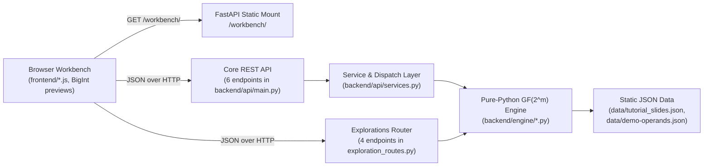

# System Architecture — Finite Field Lab ($GF(2^m)$)

**Course:** EECE 455 — Cryptography and Network Security (Project-3)  
**Primary Field:** $GF(2^{163})$ | **Extended Standard Fields:** $m \in \{163, 233, 239, 283, 409, 571\}$ | **Textbook Fields:** $2 \le m \le 8$

---

## 1. High-Level Architecture

The platform runs as a single local FastAPI ASGI application (`backend.api.main:app`) that serves both the **10-endpoint JSON REST API** and the **zero-build ES-module web workbench** mounted at `/workbench/`. Pure finite-field mathematics live strictly inside `backend/engine/` with zero web-framework dependencies.



---

## 2. Layer & Module Responsibilities

| Layer | Directory | Ownership | Responsibilities |
| :--- | :--- | :--- | :--- |
| **Pure Math & Utilities** | `backend/engine/` | Hussein Abbas (M1), Hassan Tarhini (M2), Husein Zahweh (M3), Ali Zahreddine (Explorations) | Canonical 13-field registry, lossless Binary/Hex/Algebraic converters, traced $+$, $-$, $\bmod$, Shift-and-XOR $\times$, carry-free $\times$, `POLY_DIVMOD`, Table 4.7 Extended Euclid $b^{-1}$, two-stage division, live verifiers, random generator, batch parser, exporter, tutorial loader, and 3 pure-Python explorations. |
| **Web API & Service Layer** | `backend/api/` | Hassan Tarhini (M2 Core), Ali Zahreddine (Integration & Explorations) | Pydantic v2 schemas (`schemas.py`), operation dispatch / timing / verification assembly (`services.py`), 4 exploration endpoints (`exploration_routes.py`), 6 core endpoints + CORS + `/workbench/` mount (`main.py`). |
| **Educational Web GUI** | `frontend/` | Ali Zahreddine (M4–M6) | Single-document 5-view lab (`index.html`, `lab.css` serving `#calculator`, `#lessons`, `#modulus`, `#aes`, `#compare`), client `BigInt` formatting (`notation.js`), zero-horizontal-scroll 3-mode trace visualizers + Step Inspector Square + 5-button playback + full-view modal (`traces.js`), standalone 7-lesson animated curriculum (`lesson-data.js`, `lessons.js`), interactive `Tutorial tour` spotlight walkthroughs (`tour.js`), exploration labs (`explorations.js`), and calculator controller (`lab.js`). |
| **Static Classroom Data** | `data/` | Hussein Abbas (M1), Ali Zahreddine (M4) | Single source of truth for the 4 tutorial slides + Ch. 4/5 presets (`tutorial_slides.json`) and 4-pair classroom upload demo (`demo-operands.json`). |
| **Benchmarks & Tests** | `benchmarks/`, `tests/` | Husein Zahweh (M3), Full Team | Multi-field EEA/division CLI benchmark (`benchmark_gf2m.py`) and unified root `pytest` suite (`tests/engine/`, `tests/api/`, `tests/e2e/`). |

---

## 3. Shared Data Contract: Polynomial Bitmask Encoding

All modules in `backend/engine/` represent every polynomial $p(x) = \sum_{i=0}^{d} c_i x^i \in GF(2)[x]$ as a **non-negative Python `int`** where bit $i$ (LSB $= 0$) equals the coefficient $c_i \in \{0, 1\}$:

* Example: $x^6 + x^4 + x^2 + x + 1 \leftrightarrow \text{01010111}_2 \leftrightarrow \text{0x57} = 87$.
* Reduction modulus $m(x)$ of degree $m$ always includes bit $m$ set to $1$, e.g., AES $x^8 + x^4 + x^3 + x + 1 \leftrightarrow \text{100011011}_2 = \text{0x11B} = 283$.
* **Stallings Course Mapping:**
  * **Chapter 4:** Polynomial basis over $\mathbb{Z}_2$, XOR add/sub, modulo reduction, Shift-and-XOR multiplication, Extended Euclid Table 4.7.
  * **Chapter 5:** AES byte arithmetic in $GF(2^8)$ modulo `0x11B` and FIPS 197 §5.1.1 SubBytes S-box.
  * **Chapter 6:** Same bit-level polynomial representation extends directly to XTS-AES tweaks in $GF(2^{128})$.
  * **Chapter 10:** Binary elliptic curves $E_{2^m}(a, b)$ over standard NIST/SEC fields $m \in \{163, 233, 239, 283, 409, 571\}$.

---

## 4. Complete REST API Reference (10 Application Endpoints + Meta)

Base URL (default): `http://127.0.0.1:8000` · Swagger OpenAPI UI: `/docs` · Web Workbench: `/workbench/`

### 4.1 Meta & Health Routes
* `GET /` — Returns `{"service": "gf2m-api", "version": "1.0.0", "docs": "/docs", "workbench": "/workbench/"}`.
* `GET /api/health` — Returns `{"status": "ok"}`.

### 4.2 Core Arithmetic & Utility Endpoints (6 Routes)

#### 1. `GET /api/fields`
* **Query:** `include_textbook: bool = true`
* **Response (`200`):** `{"count": 13, "fields": [{"m", "category", "name", "reduction_poly_hex", "reduction_poly_bin", "reduction_poly", "element_bits"}, ...]}`

#### 2. `POST /api/calculate`
* **Request:**
  ```json
  {
    "m": 163,
    "operation": "multiply",
    "a": "57",
    "b": "83",
    "input_base": "hex",
    "output_base": "hex",
    "trace": true
  }
  ```
  * Accepts aliases `poly_a` / `poly_b`, short operation names (`sub`, `mod`, `mul`, `inv`, `div`), and `input_base` / `output_base` in `{"hex", "bin", "binary", "algebraic"}`.
* **Response (`200`):**
  ```json
  {
    "operation": "multiply",
    "field": { "...": "..." },
    "operands": { "a": { "hex": "...", "bin": "...", "poly": "...", "degree": 6, "bit_length": 7, "hamming_weight": 5 }, "b": { "...": "..." } },
    "result": { "hex": "...", "bin": "...", "poly": "...", "degree": 13, "bit_length": 14, "hamming_weight": 9 },
    "trace": { "...": "..." },
    "initial_reduction": null,
    "verification": null,
    "metrics": { "elapsed_ms": 0.12, "result_bit_length": 14, "result_hamming_weight": 9 },
    "share_token": "76317c..."
  }
  ```
* **Errors (`400`):** Returns `{"detail": "..."}` on invalid base/digits, unsupported degree, or missing operand `B`. On zero inverse or division by zero (`b mod m(x) == 0`), also includes `"gcd"` and `"trace"` (Table 4.7 Step 0 with $B_3 = 0$).

#### 3. `POST /api/random-polynomials`
* **Request:** `{"m": 163, "density": "sparse", "count": 2, "output_base": "hex", "seed": null}` (`sparsity` accepted as alias for `density`).
* **Response (`200`):** `{"field", "density", "seed", "a", "b", "m", "output_base", "polynomials": [...]}`.

#### 4. `POST /api/parse-polynomials`
* **Request:** `{"content": "<raw .txt or .json text>", "filename": "demo-operands.json", "default_base": "hex"}`.
* **Response (`200`):** `{"count": 4, "pairs": [{"a": "57", "b": "83", "base": "hex"}, ...]}` (`400` with `"parse error: ..."` on malformed files).

#### 5. `POST /api/export-calculation`
* **Request:** `{"calculation": <CalculateResponse>, "format": "md" | "json", "download": false}`.
* **Response (`200`):** Either JSON `{"filename", "media_type", "content"}` or streamed file download with `Content-Disposition: attachment` when `download: true`.

#### 6. `GET /api/tutorial`
* **Response (`200`):** `{"version": "1.0", "title": "...", "slides": [ ...4 slides + presets on Slide 4... ]}`.

### 4.3 Interactive Exploration Endpoints (4 Routes)

| Method | Path | Request Body | Response Highlights |
| :--- | :--- | :--- | :--- |
| `POST` | `/api/explorations/modulus` | `{"polynomial": "x^8 + 1", "input_base": "algebraic"}` | `irreducible`, `degree`, `checks` (GCD checkpoints), `witness` (two nonzero factors with remainder `0`), `split_with_berlekamp`. |
| `POST` | `/api/explorations/aes-sbox` | `{"byte": "53", "input_base": "hex"}` | `input`, `inverse`, `inverse_trace` (Table 4.7 or `null` for `00`), 6 `affine_rows`, `output` (`ED` for `53`, `63` for `00`). |
| `POST` | `/api/explorations/compare-multiplication` | `{"m": 8, "a": "57", "b": "83", "input_base": "hex"}` | `agree`, `shift_result`, `shift_trace`, `raw_product`, `quotient`, `remainder`, `division_steps`. |
| `GET` | `/api/explorations/multiplication-benchmarks` | *(none)* | `{"seed": 455, "trials": 31, "rows": [{"m": 163, "agree": true, "shift_xor_us": ..., "long_division_us": ...}, {"m": 571, ...}]}`. |

---

## 5. Local Setup, Launch & Verification Commands

```powershell
# 1. Create virtual environment and install runtime dependencies
python -m venv .venv
.\.venv\Scripts\python.exe -m pip install -r requirements.txt

# 2. Launch the server (either command works from the repository root)
.\.venv\Scripts\python.exe run.py
# or:
.\.venv\Scripts\python.exe -m uvicorn backend.api.main:app --reload

# 3. Install dev/test dependencies and run the full unified test suite
.\.venv\Scripts\python.exe -m pip install -r requirements-dev.txt
.\.venv\Scripts\python.exe -m playwright install chromium
.\.venv\Scripts\python.exe -m pytest -v

# 4. Run the multi-field Extended Euclid & Division benchmark
.\.venv\Scripts\python.exe -m benchmarks.benchmark_gf2m --trials 10 --seed 455
```
